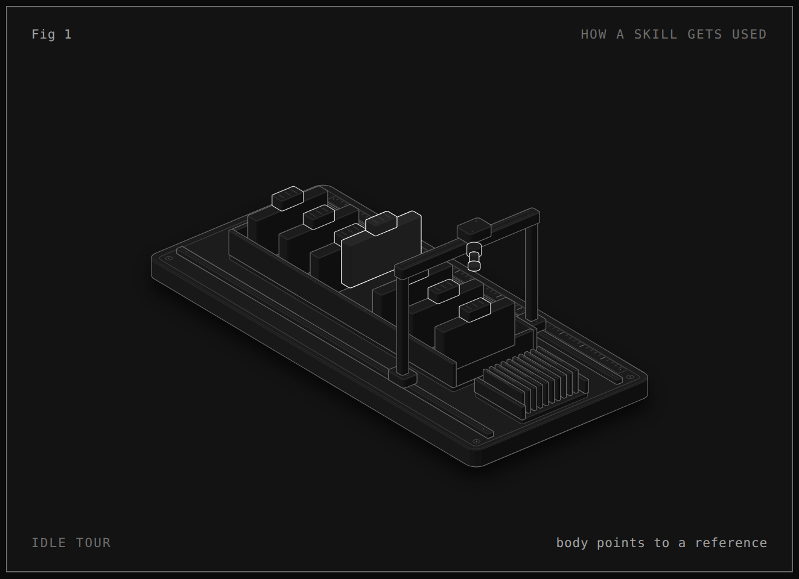
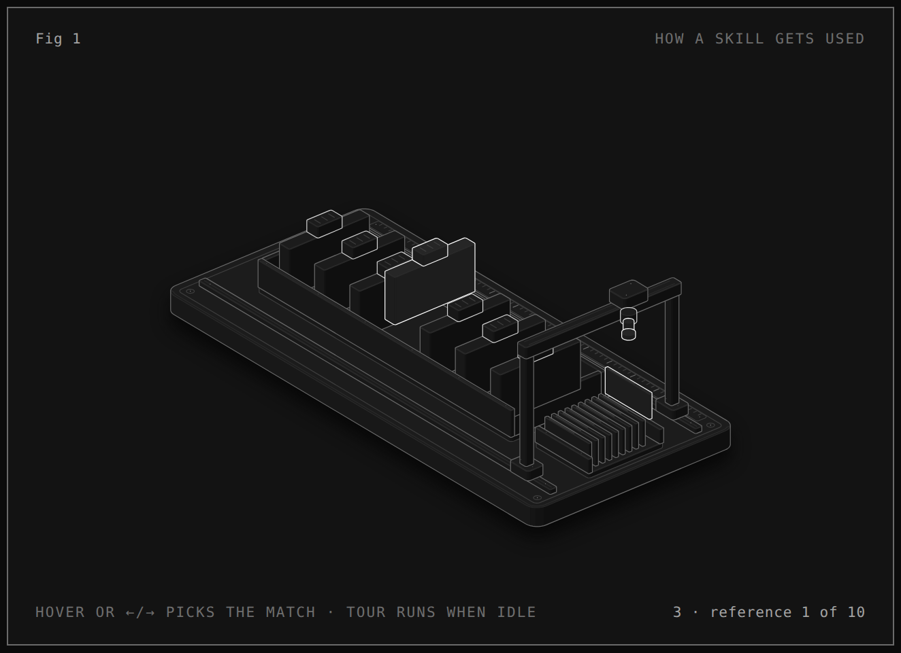

# Anatomy: explain an idea by drawing it as a machine

A hands-on tour of [Anatomy](https://github.com/wheresryan22/anatomy), a Claude Code skill by Ryan ([@wheresryan22](https://github.com/wheresryan22), MIT license). You ask for a figure that explains a technical idea, and Anatomy has Claude invent a real-looking machine whose moving parts *are* the idea, then build it as an interactive isometric drawing in one HTML file you can open in any browser.

In the demo you will ask it to draw **how a Claude Code skill gets used** (fitting, since today is a tour of skills), open the result, and then improve it with one follow-up prompt.

Everything below was run for real on **2026-10-22** with:

| Tool | Version |
|---|---|
| Anatomy | `main` at commit `1482e84` (18 Oct 2026; the project has no numbered releases yet) |
| Claude Code | 2.1.309, model Sonnet |
| Node.js | 22.23.3 (Anatomy needs 20.10 or later) |
| `skills` installer (`npx skills`) | 1.7.4 (needs Node 22.20 or later) |
| Chromium (for the skill's own screenshot checks) | Playwright's Chromium build 1248 |

**Time:** 20-45 minutes. **Cost:** our two prompts cost **$0.60 + $0.71** of Sonnet usage, about **$1.30** in total, and under 5 minutes of waiting. A bigger figure, or one where Claude does every check the skill asks for, can cost several dollars.

## The idea in one paragraph

Most AI "diagrams" are boxes and arrows. Anatomy's rule is the opposite: *the object is the explanation*. Ask it to explain a cache and it might build a pin-tumbler lock that only turns when every pin matches. It ships with a small drawing kit (plain JavaScript, no `npm install`), nine finished example figures, and long reference guides on craft, motion and checking. Claude reads the skill, writes a short Node build script using the kit, runs it to produce a standalone HTML page, and then takes screenshots of its own work in a headless browser to check it. What you get back is source you own: the build script and the page it writes.

## What a skill is (30-second refresher)

A skill is just a folder with a `SKILL.md` file in it. Claude Code looks in two places:

- `~/.claude/skills/<name>/` - available in every project on your computer ("global").
- `<your project>/.claude/skills/<name>/` - available only in that project.

At startup Claude reads only the short description at the top of each `SKILL.md`. It reads the full instructions only when your request matches, or when you type `/<name>`. That is exactly what today's figure is about.

## Setup

You need git, Node.js 22, and [Claude Code](https://claude.com/claude-code). On Windows, use WSL. Chrome or Chromium is optional: the skill uses it to screenshot and check its own work, and skips those checks (with an error you can ignore) if it can't find one.

### The normal install (what upstream recommends)

```bash
npx skills@1.7.4 add wheresryan22/anatomy -g -a claude-code
```

This copies the whole repository (about 27 MB at the tested commit, examples included) into `~/.claude/skills/anatomy`, so it works in every project. The installer needs Node 22.20 or later. `-g` means global. Leave it out to install into the current project only. The installer sends anonymous usage counts to its makers; set `DISABLE_TELEMETRY=1` first if you would rather it didn't.

### The install for this lesson (one project only, pinned)

So the class all gets the same version, and nothing lands in your global setup, use the helper script. It makes a practice folder, copies in the brief, and clones Anatomy at the tested commit into that folder's `.claude/skills/`:

```bash
git clone https://github.com/vasuchettyphd/ai-dev-course.git
cd ai-dev-course/advanced/anatomy
demo/setup.sh
```

Expected output (the `...` stands for wherever you cloned the course):

```
anatomy at 1482e84

Ready: .../advanced/anatomy/demo/practice/skill-figure
Skill installed at: .../advanced/anatomy/demo/practice/skill-figure/.claude/skills/anatomy/SKILL.md
Next: cd ".../advanced/anatomy/demo/practice/skill-figure" && claude
```

`demo/practice/` is ignored by git. Check the skill is there:

```bash
cd demo/practice/skill-figure
ls .claude/skills/anatomy
```

```
CHANGELOG.md  CODE_OF_CONDUCT.md  CONTRIBUTING.md  LICENSE  README.md  SECURITY.md
SKILL.md  agents  evals  examples  kit  references  scripts  tests
```

### Look before you run (always, with any skill)

A skill runs with the same permissions you give Claude. Before using one, skim its `SKILL.md` and anything in `scripts/`. We did this for Anatomy:

- `SKILL.md` and `references/` are plain instructions about drawing.
- The scripts in `scripts/` start a headless Chrome on your machine to take screenshots. They use a throwaway browser profile, allow the page to read local files, turn off Chrome's sandbox on Linux, and only talk to that local browser. That is fine for pages you or Claude made; the author's own security notes say not to point them at pages you don't trust.
- `scripts/publish.mjs` can open a pull request to the author's community gallery on GitHub. The skill says to do that **only when you ask** and only after you say yes to a dry run. We never ran it.
- Nothing else reaches the internet, and the skill installs no hooks or background processes.

## Demo: draw "how a Claude Code skill gets used"

### Step 1: read the brief

```bash
cat brief.md
```

[`brief.md`](demo/brief.md) holds the true facts the figure must show: 7 installed skills, only their short descriptions loaded at startup (each at most 1,024 characters), one skill opened in full when a request matches (Anatomy's own `SKILL.md` is about 185 lines), and its 10 reference files opened only if needed. Anatomy insists that every number on a figure comes from real facts, so giving it a brief like this is the single best thing you can do for the result.

### Step 2: ask for the figure

Start Claude Code in the practice folder (`claude`) and paste:

```text
/anatomy Read brief.md and make one figure that explains how a Claude Code skill gets used, as described there. Size: Figure, and keep it quick for a classroom demo: one standalone HTML page in the dark theme, written to figure/ in this folder. Check it once with a single desktop screenshot and fix what you see. Skip the light theme, the phone and close-up captures, the audit, printing and publishing. When done, say in two sentences what object you invented and what moves.
```

Why all the "skip" instructions? Left to itself, Anatomy does a very thorough job: both themes, phone and close-up screenshots, a geometry audit. That is great for a real project and slow and costly for a class. Telling it what to skip keeps the run to a few minutes.

Claude will ask permission for a few things along the way (running `node`, writing files). Say yes. If it tries to write its build script inside `.claude/skills/anatomy/examples/`, say no: your work belongs in your project, not inside the installed skill. In our run that write was refused and it moved on to `figure-src/` by itself.

We ran both prompts headless (`claude -p "..." --model sonnet`, with the follow-up sent using `--continue`), which behaves the same as typing them into a session. Our first run took **3.5 minutes, 25 turns and $0.60**. Claude's final answer:

> The figure is at `figure/skill-use.html` (dark theme, one standalone page). I checked it with one desktop screenshot. That showed the readout running into the hint, so I shortened both. I did not re-shoot after that fix, so the shortened text hasn't been checked on screen.
>
> The object is a reading gantry on rails over a rack of 7 folders, each with a raised tab, plus a tray of 10 reference sheets. The gantry scans the tabs (descriptions, at most 1,024 characters each), lifts the one matching folder out and lights it (the `SKILL.md` body, about 185 lines). It then slides to the tray and lifts a single sheet, while the readout counts what has loaded at each stage.

Your result will differ. Anatomy invents the object fresh every time, so one classmate may get a gantry over folders and another a jukebox or a card catalogue. That is the point of the exercise: compare them.

It left two things behind:

```bash
ls figure figure-src
```

```
figure:
skill-use.html

figure-src:
build.mjs  shot.png
```

- `figure-src/build.mjs` (about 220 lines) is the build script. Run `node figure-src/build.mjs` to rebuild the page after editing it.
- `figure/skill-use.html` (about 150 KB) is the finished page. Everything is inside it: no internet needed to view it.
- `figure-src/shot.png` is the screenshot Claude took to check its own work.

### Step 3: open it

Open `figure/skill-use.html` in your browser (double-click it, or on WSL run `explorer.exe figure` and double-click from there). Watch for about 10 seconds. Our version went through its idle tour like this:

| Moment | What moves | Readout (bottom right) |
|---|---|---|
| ~2 s | The gantry glides along the rack, reading each folder tab | `1 · tab 3 of 7 · ≤ 1,024 chars` |
| ~4 s | It stops over the matching folder | `match · skill 4 of 7` |
| ~6 s | That folder rises out of the rack and lights up | `body points to a reference` |
| ~8 s | A sheet in the front tray moves (barely) | `3 · reference 1 of 10 · on demand` |



Keep watching and at about 8 seconds the readout says `3 · reference 1 of 10 · on demand`, then `loaded: 1 body + 1 reference`, then `back to descriptions only`, and the tour starts over. But look at the reference tray at the front during that stage: the sheet barely rises and is not lit, so it is easy to miss. Claude's summary said it "lifts a single sheet". Trust what you see in the browser over what the summary says.

### Step 4: iterate once

Look critically. In ours, stage 3 (the reference sheet) was too faint to notice, and you could only watch, not play. So the follow-up prompt, in the same session:

```text
Two changes to the figure. 1) In stage 3 the gantry should visibly lift one sheet out of the reference tray and light it, the same way the matched folder lifts, and the readout should say "reference 1 of 10". 2) Let the reader drive it: hovering or arrow keys pick which folder is the match, and the idle tour only runs when nobody is touching it. Change the hint to say so. Rebuild figure/skill-use.html and check it with one desktop screenshot taken about 4 seconds in.
```

Our follow-up took **45 seconds, 9 turns and $0.71** (more per turn than the first run, because the whole conversation so far, including the build script, is sent along with each new step). Claude's answer:

> I rebuilt `figure/skill-use.html` with both changes. I checked it with one desktop screenshot at about 4 seconds, and that shot only covers stages 1 and the match. I haven't seen stage 3 or any hover or arrow-key input on screen.
>
> - **Stage 3:** the head now always picks reference 1. It lifts that sheet and lights it the way the matched folder lifts, and the readout says "3 · reference 1 of 10".
> - **Driving it:** hovering over a folder, or pressing ←/→, Home or End, picks the match. The gantry restarts from where it is, runs the three stages, and holds the loaded pose. The idle tour resumes after 4 seconds with no input.
> - **Hint:** "Hover or ←/→ picks the match · tour runs when idle".
>
> When you pick a folder mid-run, any lifted folder or sheet drops instantly instead of easing down.

Notice it told you plainly what it did *not* check. That is your cue to check it yourself. We did, with the skill's own screenshot tool, sampling the readout every second. This needs Chrome or Chromium (see Troubleshooting) and costs nothing, because no model is involved. Run it in `demo/practice/skill-figure`:

```bash
node .claude/skills/anatomy/scripts/capture.mjs figure/skill-use.html --out shots/t.png --wait 100 --times 1000,2000,3000,4000,5000,6000,8000,9000
```

```
readout over time: +1000ms "1 · tab 1 of 7 · ≤ 1,024 chars" · +2000ms "1 · tab 3 of 7 · ≤ 1,024 chars" · +3000ms "1 · tab 4 of 7 · ≤ 1,024 chars" · +4000ms "match · skill 4 of 7" · +5000ms "2 · SKILL.md · ~185 lines" · +6000ms "body points to a reference" · +8000ms "3 · reference 1 of 10" · +9000ms "loaded: 1 body + 1 reference"
console: clean
```

(Trimmed slightly. `console: clean` means the page threw no errors.) So the full story now plays out in about 9 seconds, and at 8 seconds the sheet is up:



Arrow keys and hover also worked when we drove them in the headless browser. One rough edge we could see: the lifted sheet is drawn close against the gantry's front post. Spotting things like that and asking for a fix is exactly how you would keep going.

Reload the page in your browser and try it.

## What to notice

- **It invented an object, not a diagram.** Nobody told it "gantry" or "folders". It turned "read short descriptions, open one, then one reference" into a machine that scans tabs, lifts one folder, then fetches one sheet.
- **The numbers come from your brief.** 7 folders, 10 sheets, 1,024 characters. Change a number in `brief.md`, ask it to rebuild, and the machine changes with it. Without a brief it would have to guess, and the skill tells it not to.
- **It checks its own work by looking.** The skill makes Claude screenshot the page and read the picture. In our first run that caught text overlapping in the card.
- **Progressive disclosure, live.** This whole run is the figure's subject: at startup Claude only knew Anatomy's one-paragraph description. Typing `/anatomy` made it read the 185-line `SKILL.md`, and across both prompts it opened one example and a few kit files, and none of the 10 reference guides.
- **You own the source.** The page comes from a short script you can read and edit. That is very different from an image generator.

## Limits and caveats

- **Quality varies run to run, and quick runs are rougher.** Our classroom-speed figures are clean but simpler than the examples in the repo (open `.claude/skills/anatomy/examples/dial-indicator/dial-indicator.html` to see the bar). The author says a full-quality "Figure" can take up to an hour and a "Hero" 2-4 hours. Asking it to skip checks trades quality for time and money.
- **Not a chart tool.** No axes or data plots. It draws machines, instruments and furniture, not people or maps. An idea with no mechanism comes out weak.
- **It costs real money.** Each long session uses a lot of tokens. Set a spending limit if you run it unattended (`claude -p ... --max-budget-usd 2`).
- **Screenshots need Chrome.** Without Chrome or Chromium the figure is still built; only the self-checks fail.
- **Installing a skill gives it your agent's permissions.** Read it first (see "Look before you run").

## Troubleshooting

**`/anatomy` is not in the list.** Make sure `SKILL.md` is at `.claude/skills/anatomy/SKILL.md` (not one folder deeper), and that you started `claude` in the practice folder. If the `.claude/skills` folder didn't exist when the session started, type `/reload-skills` or restart.

**`npx skills add` says Node is too old.** The installer needs Node 22.20 or later, even though Anatomy itself runs on 20.10. Upgrade Node, or use `demo/setup.sh`, which uses git instead.

**The screenshot step fails with `Chrome exited before startup: 127`.** Chrome was found but is missing system libraries. We hit this on WSL, where the skill found a Playwright copy of Chromium without the `libnss3` and `libasound2` libraries it needs. Easiest fix: install Google Chrome (`sudo apt install ./google-chrome-stable_current_amd64.deb` after downloading it from google.com/chrome) or point the skill at another browser with `export CHROME_PATH=/path/to/chrome` before starting `claude`. Or tell Claude to skip screenshots; the page still works.

**The page is blank or doesn't move.** Open the browser's developer console (F12) and paste any red error into Claude. Also check you are not in "reduce motion" mode: under reduced motion, Anatomy figures hold still on purpose.

**It is taking ages / costing a lot.** Interrupt with Esc and ask for less: "Stop the checks. Build the page as it is and tell me where it is." Be explicit about skipping the light theme, phone captures, audit and print.

**It wants to publish to a gallery.** It only does that if you ask. If it ever asks, you can say no.

## Clean up

Remove the practice project (the skill was only ever installed inside it):

```bash
cd ../../..         # back to advanced/anatomy
rm -rf demo/practice
```

If you used the normal global install instead:

```bash
npx skills@1.7.4 remove anatomy -g      # or: rm -rf ~/.claude/skills/anatomy
```

## Files

| File | What it is |
|---|---|
| [`demo/setup.sh`](demo/setup.sh) | Makes the practice project in `demo/practice/skill-figure` and clones Anatomy at the tested commit into its `.claude/skills/`. Pass a folder name to put it somewhere else. |
| [`demo/brief.md`](demo/brief.md) | The facts the figure must show. `setup.sh` copies it into the practice project. |
| [`sample-output/skill-use.html`](sample-output/skill-use.html) | The final figure from our run, after the follow-up prompt. Open it in a browser. |
| [`sample-output/build.mjs`](sample-output/build.mjs) | The script that built it, with its paths changed to relative ones. |
| [`sample-output/v1-lifted.png`](sample-output/v1-lifted.png) | Screenshot of the first version at about 6 seconds. |
| [`sample-output/v2-at-8s.png`](sample-output/v2-at-8s.png) | Screenshot of the second version at about 8 seconds. |
| `.gitignore` | Keeps `demo/practice/`, screenshots and other generated files out of git. |

The sample output lets you see the result without spending anything. To rebuild the page yourself after `demo/setup.sh`, run this from `advanced/anatomy`:

```bash
cd demo/practice/skill-figure
mkdir -p figure figure-src
cp ../../../sample-output/build.mjs figure-src/build.mjs
node figure-src/build.mjs
```

It writes `figure/skill-use.html`, byte for byte the same as `sample-output/skill-use.html`.

## Where to read more

- Anatomy: https://github.com/wheresryan22/anatomy (README, gallery and the examples)
- Claude Code skills: https://code.claude.com/docs/en/skills
- The open Agent Skills format: https://agentskills.io
