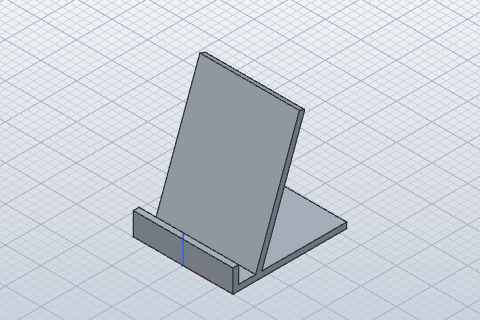
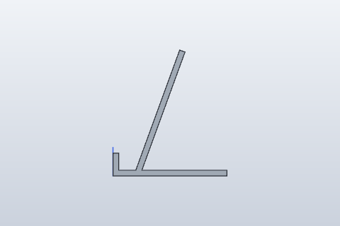
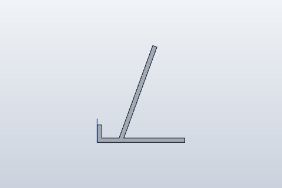

# SolidCraft: let Claude design a 3D-printable part

A hands-on lesson for [SolidCraft](https://github.com/tangency-labs/solidcraft), a free, open-source CAD program (software for designing physical parts) that Claude Code can drive for you. You will describe a phone stand in plain English, watch Claude build it as a real parametric 3D model, change one size, and export files you could send to a 3D printer or a machine shop.

Everything here was run for real on **2026-10-22** with:

| Tool | Version |
|---|---|
| SolidCraft (`solidcraft-cli`) | 0.19.0 (Linux x86_64 release, published 2026-10-22) |
| SolidCraft agent skills | from the `v0.19.0` tag of the same repo |
| Claude Code | 2.1.309, model Sonnet |
| OS | Ubuntu on WSL2 (Windows 11), no GPU: renders used the software renderer |

**Time:** 20-45 minutes. **Cost:** about $0.35 of model usage for the whole demo (we measured $0.26 for the build and $0.09 for the change).

SolidCraft moves fast (0.19.0 came out the same day we tested). The setup script pins 0.19.0 so your results match ours.

## The idea in one paragraph

Asking an AI to "make me a 3D model" usually gets you a dead mesh: a lump of triangles you can't resize without starting over. Real CAD is *parametric*: the part is a recipe of sketches and features driven by named sizes (width, thickness, angle), so changing one number rebuilds everything. SolidCraft is a CAD app that exposes that recipe to Claude through an **MCP server** (a plug-in that gives Claude new tools: build, measure, screenshot, export). Its **skills** teach Claude how to use those tools well: plan the part as numbers, build it in a few big steps, and check every step by measuring the volume against a value it worked out by hand. The result is a model you own, can edit, and can print.

## What SolidCraft gives Claude Code

SolidCraft is not one skill. It is an app with three pieces that work together:

| Piece | What it is | What it does for Claude |
|---|---|---|
| `solidcraft-cli mcp` | An MCP server, built into the SolidCraft program | 17 tools: `batch`, `execute`, `measure`, `screenshot`, `set_parameter`, `export`, `save`, `open`, ... |
| `.claude/skills/solidcraft-*` | Four [Agent Skills](https://agentskills.io) (plain markdown instructions) | Teach Claude the workflow and the traps, so it builds in a few calls instead of fumbling |
| The desktop app / [browser app](https://solidcraft.io/app) | A normal CAD window | Optional: lets *you* look at, edit and fine-tune what Claude made |

The four skills, each loaded only when it fits the request:

| Skill | Claude loads it when it |
|---|---|
| `solidcraft-modeling` | builds a new part |
| `solidcraft-editing` | changes or fixes an existing design |
| `solidcraft-checking` | wants extra checks: parameter ranges, regression tests, exact STEP comparisons |
| `solidcraft-mechanisms` | builds assemblies with moving joints (hinges, sliders) |

SolidCraft was started by GitHub user `bherbruck` and now lives under the `tangency-labs` organisation. It is written in Rust, licensed MIT or Apache-2.0, and builds its geometry on the open-source Rust CAD kernel [truck](https://github.com/ricosjp/truck), with its own fixes and constraint solver (it does not use FreeCAD or OpenCASCADE). Docs: <https://docs.solidcraft.io/>.

**Two words you'll see:**
- **STL** is a mesh of triangles. 3D printer software (a *slicer*, such as PrusaSlicer, Bambu Studio or Cura) takes STL or 3MF.
- **STEP** is exact CAD geometry. Engineers, machine shops and other CAD programs (Fusion, Onshape, FreeCAD) take STEP.

## Setup

You need:

- **git** and **curl** (the script checks for both and stops if either is missing),
- [Claude Code](https://claude.com/claude-code),
- **Linux** (tested, on WSL) or **macOS (untested: the script has a macOS branch, but we never ran it on a Mac)**. On Windows, use WSL.

```bash
git clone https://github.com/vasuchettyphd/ai-dev-course.git
cd ai-dev-course/advanced/solidcraft
demo/setup.sh
```

Expected output (`...` stands for wherever you cloned the course):

```text
Downloading solidcraft-0.19.0-linux-x86_64.tar.gz (about 60 MB) ...
Checking the download's SHA-256 checksum ...
Checksum OK.
solidcraft-cli 0.19.0
Making a fresh practice folder in .../advanced/solidcraft/demo/practice ...

Skills installed for this folder only:
solidcraft-checking
solidcraft-editing
solidcraft-mechanisms
solidcraft-modeling

Ready. Next:
  cd .../advanced/solidcraft/demo/practice
  claude
```

What the script did (read it first, it is short: [`demo/setup.sh`](demo/setup.sh)):

1. Downloaded the SolidCraft 0.19.0 release into `demo/bin/` and checked its SHA-256 checksum. The expected value is written into the script itself, and the release's own `SHA256SUMS.txt` must agree with it. Nothing is installed system-wide, and there is no `curl | sh`.
2. Made `demo/practice/` with the four skills in `.claude/skills/` (project-scoped: they exist only in this folder), plus a small marker file, `.solidcraft-practice`, that says the script made this folder.
3. Wrote `demo/practice/.mcp.json`, which tells Claude Code how to start the SolidCraft MCP server:

```json
{
  "mcpServers": {
    "solidcraft": {
      "command": "/home/you/ai-dev-course/advanced/solidcraft/demo/bin/solidcraft-cli",
      "args": ["mcp", "--allow-path", "/home/you/ai-dev-course/advanced/solidcraft/demo/practice/out"]
    }
  }
}
```

`--allow-path` matters: by default the server can only read and write files in the open design's folder, its own scratch folder and its recovery folder. That is a good safety rule. We add `out/` so Claude can save and export there.

Run `demo/setup.sh` again any time to get a fresh practice folder (the download is skipped if it's already there). The script only deletes a practice folder that has its marker file. If the folder exists without it (for example, you made it yourself), the script stops and changes nothing; delete the folder yourself or choose another one with `SOLIDCRAFT_PRACTICE=/some/new/folder demo/setup.sh`.

### The normal install (outside this course)

Once you use SolidCraft for real, the upstream way is to install the app ([downloads](https://solidcraft.io/download), `winget install bherbruck.SolidCraft`, or `sudo snap install solidcraft`) and then:

```bash
claude mcp add solidcraft -- solidcraft-cli mcp                  # the MCP server, for you on this machine
git clone --depth 1 https://github.com/tangency-labs/solidcraft
cp -r solidcraft/skills/solidcraft-* ~/.claude/skills/            # the skills, for all projects
```

We don't do that here, so nothing in your global Claude Code setup changes.

## The demo

### Step 1: start Claude Code and approve the server

```bash
cd demo/practice
claude
```

The first time, Claude Code finds `.mcp.json` and asks whether to use the `solidcraft` server from this project. Approve it. (Before approval, `claude mcp list` run in this folder shows `solidcraft: ... - ⏸ Pending approval (run claude to approve)`, with `claude` in backticks.)

Check it connected by typing `/mcp`. You should see `solidcraft` with status connected. If you want to see the server's tools without Claude, this talks to it directly (no model, no cost):

```bash
printf '%s\n' \
  '{"jsonrpc":"2.0","id":1,"method":"initialize","params":{"protocolVersion":"2025-06-18","capabilities":{},"clientInfo":{"name":"me","version":"1"}}}' \
  '{"jsonrpc":"2.0","method":"notifications/initialized"}' \
  '{"jsonrpc":"2.0","id":2,"method":"tools/list"}' \
  | ../bin/solidcraft-cli mcp 2>/dev/null | grep -o '"name":"[a-z_]*"' | sort -u
```

It prints the 17 tool names, from `"name":"batch"` to `"name":"undo"`, plus the server's own name, `"name":"solidcraft"`.

### Step 2: describe the part

Paste the prompt from [`demo/prompts/1-build.md`](demo/prompts/1-build.md):

> Use SolidCraft (the solidcraft MCP server) to design a parametric phone stand.
>
> - A flat base plate, a back rest leaning back at an angle, and a front lip that stops the phone sliding off.
> - Make these user parameters so I can change them later: width, base_depth, thickness, back_height, angle (from vertical), lip_height, slot (the gap between the back rest and the lip, for the phone's thickness).
> - Start with width 70 mm, base_depth 80 mm, thickness 4 mm, back_height 90 mm, angle 20 deg, lip_height 12 mm, slot 12 mm.
> - Check it with measure against the volume you expect, then take one iso screenshot.
> - Save the design to out/phone-stand.solidcraft and export out/phone-stand.stl and out/phone-stand.step.
> - Finish with a short table of the parameters, the measured volume and bounding box.

Notice the prompt never names a skill. Here is what Claude did in our run (1 minute, 20 turns, $0.26):

1. **Loaded the `solidcraft-modeling` skill on its own**, then read the skill's `reference.md`.
2. Ran `inspect_design` to check the session was empty, and one filtered `list_commands {"filter":"rectangle"}`.
3. Sent the parameters, base sketch, base extrude, lip sketch and lip extrude as **one `batch`**. It failed at step 17 (it had put `measure` inside the batch, which is a tool, not a command), so SolidCraft **rolled the whole batch back**. Claude fixed it, hit one more error (`that dimension is already determined by other constraints`), fixed that too, and the third try succeeded.
4. Built the leaning back rest in two more batches: a rectangle on the side plane, dimensioned with `thickness + slot`, `back_height` and `back_height * sin(angle)`, then extruded `width` wide.
5. Ran `measure` and compared it with its hand calculation, took an iso screenshot, saved and exported.

Its final answer (copied from the run):

```text
The phone stand is built, and its measured volume matches my hand calculation. I saved it to
`out/phone-stand.solidcraft` and exported `out/phone-stand.stl` and `out/phone-stand.step`.

| Measurement | Value |
|---|---|
| Volume | 50,756.18 mm³ (expected 50,756.2) |
| Bounding box X | -35 to 35 mm (70 mm) |
| Bounding box Y | 0 to 80 mm |
| Bounding box Z | 0 to 88.57 mm |

I took `back_height` as the length of the slab along its lean, and `lip_height` as the height
above the base top. Say so if you meant them differently.
```

And `ls -la out` afterwards:

```text
-rw-r--r-- 1 you you 16680 Oct 22 17:05 phone-stand.solidcraft
-rw-r--r-- 1 you you 10667 Oct 22 17:05 phone-stand.step
-rw-r--r-- 1 you you  1884 Oct 22 17:05 phone-stand.stl
```

The part (rendered with `solidcraft-cli snapshot`, see Step 4):



Your run will not be word-for-word the same. Claude may name things differently or fail a batch in a different place. What should match: 7 user parameters, one body, a volume of about 50,756 mm³ and a height of 88.57 mm (4 mm base + 90 × cos 20°).

### Step 3: change it the way a customer would

Start a **new** session (`/exit`, then `claude`) so Claude has no memory of building it, and paste [`demo/prompts/2-change.md`](demo/prompts/2-change.md):

> Open out/phone-stand.solidcraft with SolidCraft.
> My phone is in a thick case: change the slot parameter to 16 mm, and make the stand 90 mm wide.
> Check with measure that only what should change changed, then save it as out/phone-stand-v2.solidcraft
> and export out/phone-stand-v2.stl. Tell me the old and new volume and bounding box.

Our run (15 seconds, 11 turns, $0.09): Claude loaded the **`solidcraft-editing`** skill this time (not the modeling one), opened the file, called `set_parameter` twice (`"errors": []` both times), measured, saved and exported. It did not rebuild anything by hand. Its answer:

```text
| | Old | New |
|---|---|---|
| Volume | 50,756.18 mm³ | 65,257.94 mm³ |
| Bounding box X | -35 to 35 (70 mm) | -45 to 45 (90 mm) |
| Bounding box Y | 0 to 80 | 0 to 80 |
| Bounding box Z | 0 to 88.57 | 0 to 88.57 |

- Width: only X grew. Y and Z are unchanged, and the old and new volumes divided by their widths
  both give the same cross-section, 725.09 mm². The volume change is entirely the extra width.
- Slot: it didn't change the volume or the bounding box. The centre of mass moved in Y, from 34.23
  to 36.20. Some of that comes from the wider body, so I can't say how much the slot contributed.
- Not checked: I didn't take a screenshot to see where the back rest sits now that the slot is
  wider. It's worth a quick look before you print.
```

That last bullet is honest and correct: widening the slot moves the back rest but doesn't change any total, so `measure` can't prove it. So look, in Step 4.

### Step 4: look at it yourself

`solidcraft-cli` renders pictures without opening a window. From `demo/practice`:

```bash
../bin/solidcraft-cli snapshot --in out/phone-stand.solidcraft    --out out/v1-side.png --view right --no-grid --width 480 --height 320
../bin/solidcraft-cli snapshot --in out/phone-stand-v2.solidcraft --out out/v2-side.png --view right --no-grid --width 480 --height 320
```

Each prints a little JSON report that includes `"renderer": "gpu-software"` (or `"gpu"` on a machine with a graphics card). `--width 480 --height 320` makes pictures the same size as ours; leave it out for a bigger 1280 x 800 picture. Open the two PNGs side by side:

| slot = 12 mm | slot = 16 mm |
|---|---|
|  |  |

The gap between the front lip and the back rest is wider on the right: the back rest moved back and kept its angle. You can check the size with a ruler on the screen. The base is 80 mm long. On the left it is about 161 pixels (2 px per mm) and the gap just above the base is about 24 px, so 12 mm. The right picture is zoomed out a little (SolidCraft fits each picture to its part): the base is about 149 px (1.86 px per mm) and the gap about 30 px, so 16 mm. Good enough to trust before printing.

Other ways to look:

- Drag `out/phone-stand.stl` into a slicer (PrusaSlicer, Bambu Studio, Cura) or any online STL viewer. It lies flat on its base and needs no supports.
- Open `out/phone-stand.solidcraft` in the SolidCraft [desktop app](https://solidcraft.io/download) or the [browser app](https://solidcraft.io/app), open the **Parameters** table and change `angle` yourself.

### Step 5 (optional): the same part with no AI at all

A SolidCraft design is a list of commands. We saved this one as a plain-JSON script, [`demo/phone-stand.json`](demo/phone-stand.json) (made with `solidcraft-cli script out/phone-stand.solidcraft --out phone-stand.json`). The CLI rebuilds it from scratch in under a second, and can change a parameter on the way ([`demo/change-angle.json`](demo/change-angle.json) sets `angle` to 30 deg):

```bash
../bin/solidcraft-cli run ../phone-stand.json --out out/no-ai.stl --out out/no-ai.step
../bin/solidcraft-cli run ../change-angle.json --in ../phone-stand.json --out out/angle30.stl --results
```

The first prints the measurement, ending with:

```text
  "total": {
    "area_mm2": 27370.29503436395,
    "edges": 30,
    "faces": 12,
    "mass_g": 65.47546790276606,
    "vertices": 20,
    "volume_mm3": 50756.17666881089
  }
```

The second prints the parameter change, including `"errors": []` and `"recomputed": 2`. The stand in `angle30.stl` leans further back, so it is shorter: 81.94 mm tall instead of 88.57 (4 + 90 × cos 30°).

This is how you would keep a design in git and rebuild it in CI, and it is also the fallback if you have no Claude Code credit left: the whole demo minus Steps 2 and 3 costs nothing.

## What to notice

- **Claude picked the right skill without being told.** "Design a ..." loaded `solidcraft-modeling`. "Open ... and change ..." loaded `solidcraft-editing`. The skill descriptions do the routing.
- **It checked its work with numbers, not vibes.** The skill tells Claude that "it reported ok" is not proof: only a `measure` that matches a hand-computed volume counts. Claude predicted 50,756.2 mm³ and measured 50,756.18. When a check *can't* prove something (the slot move), it said so.
- **Failure was cheap.** Two of its batches failed, and each rolled back completely, so it never left a half-built mess. Compare this with an agent that edits files one by one.
- **Parametric means the second request was tiny.** The change cost a third of the build and took 15 seconds, because Claude only called `set_parameter`. Every sketch was fully constrained (0 degrees of freedom), so nothing drifted.
- **Ambiguity got surfaced, not hidden.** "back_height" could mean the slab's length or its vertical height. Claude picked one and told us. For a real product, you would answer, and that answer becomes a parameter.
- **For a venture:** this is the loop behind custom-fit products (phone stands for a specific case, brackets for a specific shelf, enclosures for a specific circuit board). The customer's numbers go in as parameters, and an STL or STEP comes out.

## Limits and caveats

- **Early software.** SolidCraft calls itself "early but usable for simple parts". Upstream reports 75 of 76 reference parts matching their expected volume and shape. Keep parts simple, and always look before you print.
- **Very new release.** We tested 0.19.0 on the day it came out. The skills say they were written for 0.8 and later, and they worked, but a future version may rename commands. Stay on the pinned version for this lesson.
- **Unsigned downloads.** The SolidCraft downloads aren't code-signed yet. Our script checks the SHA-256 checksum against a value we pinned in the script on the day we tested, and against the release's `SHA256SUMS.txt`. That proves the file is the one we tested, not who built it. On macOS the script clears the quarantine flag so the CLI runs.
- **We tested Linux (WSL) only.** The macOS branch of `setup.sh` uses the `solidcraft-cli-0.19.0-macos-universal.zip` release asset, whose layout we checked, but we did not run it on a Mac.
- **The desktop app was not tested.** We ran everything headless (no window), because the test machine has no display. Upstream also supports a "bridged" mode, where you watch Claude model live in the app: start the app with `solidcraft --control 7878` and the server with `solidcraft-cli mcp --connect 127.0.0.1:7878` (see [docs/mcp.md](https://github.com/tangency-labs/solidcraft/blob/main/docs/mcp.md)). We describe it but did not run it.
- **How we drove Claude.** For repeatable results we ran both prompts with `claude -p` (no chat window) instead of an interactive session:

  ```bash
  claude -p "$(cat ../prompts/1-build.md)" --model sonnet --permission-mode acceptEdits \
    --mcp-config .mcp.json --strict-mcp-config --allowedTools mcp__solidcraft Skill Read
  ```

  `--mcp-config .mcp.json` is needed in this mode because the one-time approval prompt from Step 1 only appears in an interactive session. The tool calls and answers quoted above come from those runs.
- **Results vary.** Same prompt, different run, different path. One run of each prompt is an anecdote, not a benchmark.
- **The MCP tools can write files.** `export`, `save`, `execute` and `batch` can write and delete files inside the allowed folders. Claude Code asks before using them unless you allow them. Keep `--allow-path` narrow; avoid `--allow-any-path`.

## Troubleshooting

| Problem | Fix |
|---|---|
| `Checksum mismatch ... - not installing.` | The download was cut short or changed. Run `demo/setup.sh` again. If it keeps failing, don't run the file: report it. |
| `... already exists, and this script did not make it, so it will not touch it.` | The practice folder exists but has no `.solidcraft-practice` marker (it was made by hand or by an older copy of the script). Look inside, delete it yourself if you don't need it, and rerun `demo/setup.sh`. Or set `SOLIDCRAFT_PRACTICE` to a new folder. |
| `fatal: ...` from git | The skills download failed (no network, or GitHub is down). Your old practice folder is left as it was. Try again later. |
| `/mcp` doesn't list `solidcraft` | You started `claude` outside `demo/practice`, or you declined the approval. Run `claude mcp reset-project-choices` in `demo/practice` and start `claude` again. |
| `solidcraft` shows as failed in `/mcp` | Run `demo/bin/solidcraft-cli --version`. If it doesn't print `solidcraft-cli 0.19.0`, rerun `demo/setup.sh`. If you moved the course folder, rerun it too: `.mcp.json` holds absolute paths. |
| Claude says a path is refused | The server only writes to allowed folders. Ask it to save under `out/`, or add another `--allow-path` in `.mcp.json`. Folders whose names start with `.` are never allowed by default. |
| Claude doesn't load a `solidcraft-*` skill | Check `ls demo/practice/.claude/skills`. Mention SolidCraft by name in the prompt. You can also ask "use the solidcraft-modeling skill". |
| Screenshots are slow, or the reply has a `cpu` warning | No GPU or software renderer was found. It still works, just slower. `demo/bin/solidcraft-cli gpu` lists what it can use. |
| ``error: unsupported format `png` `` | You used `run --out x.png`. `run` exports models (STL, STEP, 3MF, ...); pictures come from `snapshot`. |
| macOS: "cannot be opened because the developer cannot be verified" | Run `xattr -d com.apple.quarantine demo/bin/solidcraft-cli`. |

## Clean up

From the `advanced/solidcraft` folder (if you are still in `demo/practice`, run `cd ../..` first):

```bash
rm -rf demo/bin demo/practice
rm -rf /tmp/solidcraft-mcp-*              # the MCP server's scratch folders (Linux)
```

SolidCraft also made a crash-recovery folder, `~/.local/share/solidcraft` on Linux. It holds nothing from this demo. If you don't use SolidCraft anywhere else, delete it too with `rm -rf ~/.local/share/solidcraft`; if you have the SolidCraft app installed, leave it, because the app keeps its unsaved work there. If you approved the project server, Claude Code remembers that choice for `demo/practice` only. Nothing else outside this folder was changed.

If you did the normal install instead: `claude mcp remove solidcraft` and `rm -rf ~/.claude/skills/solidcraft-*`.

## Files

| Path | What it is |
|---|---|
| `.gitignore` | Keeps `demo/bin`, `demo/practice` and generated models out of git |
| `demo/setup.sh` | Downloads pinned SolidCraft 0.19.0 into `demo/bin`, checks the pinned checksum, makes `demo/practice` with the skills and `.mcp.json` |
| `demo/prompts/1-build.md` | The build prompt (Step 2) |
| `demo/prompts/2-change.md` | The change prompt (Step 3) |
| `demo/phone-stand.json` | The finished design as a plain command script (Step 5) |
| `demo/change-angle.json` | A one-line script that sets `angle` to 30 deg (Step 5) |
| `sample-output/` | What our run produced: the design (`.solidcraft`), `STEP`, `STL`, and three small PNG renders |
